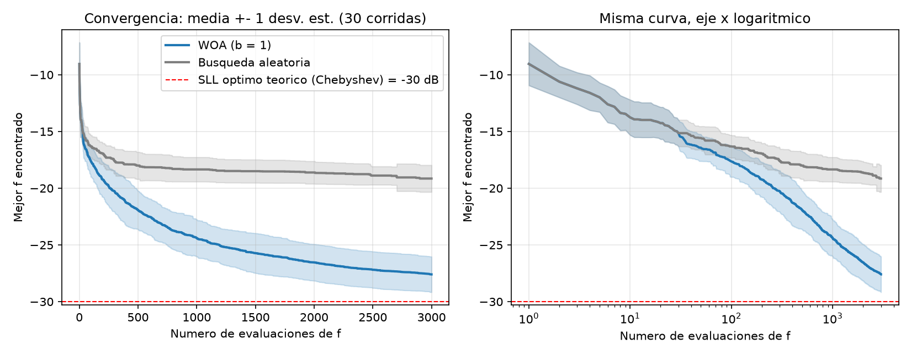
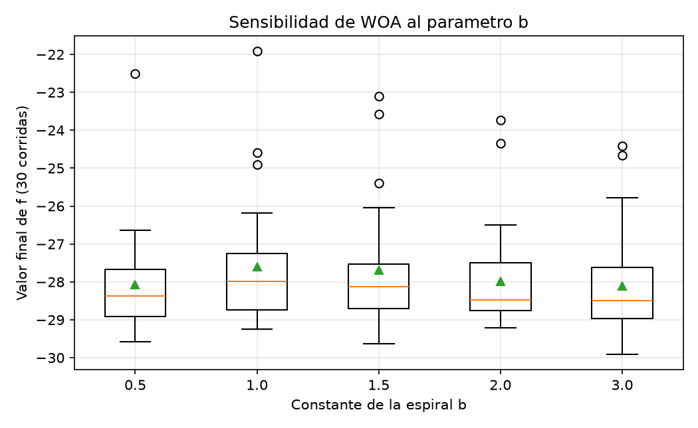
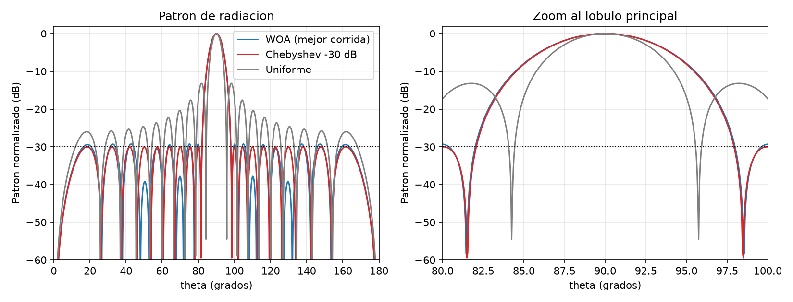
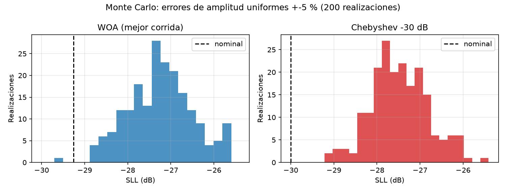
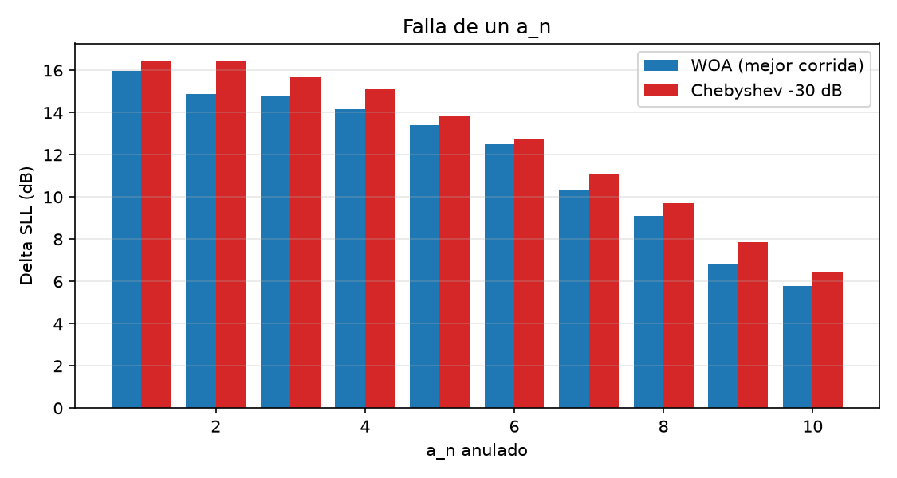
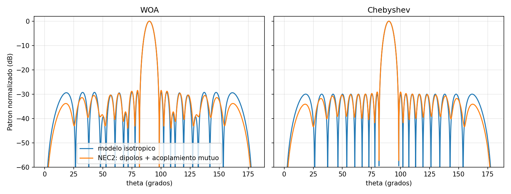

# Trabajo aplicado T1 – Síntesis de un arreglo lineal de antenas con WOA

**Asignatura:** Optimización · **Autor:** Octavio Bedoya Vélez
**Algoritmo:** Whale Optimization Algorithm (WOA) · **D = 10** · **Presupuesto:** 3 000 evaluaciones por corrida
**Entrega:** 25 de noviembre de 2026 · **Repositorio:** https://github.com/andres5984velez/Optimizacion_T1_grupo4

---

## 1. Descripción del problema y del modelo

En radar, comunicaciones satelitales y estaciones base, los lóbulos laterales captan interferencia y desperdician potencia. Ajustando las amplitudes de excitación de los elementos de un arreglo se reduce el nivel de lóbulos laterales (SLL), a costa de ensanchar el haz principal.

Se modela un arreglo lineal *broadside* de 2M = 20 elementos isotrópicos, con separación d = λ/2 (k·d = π), fase uniforme y excitaciones simétricas respecto al centro. El factor de arreglo es:

$$AF(\theta) = 2\sum_{n=1}^{10} a_n \cos\left[\left(n-\tfrac12\right) k d \cos\theta\right]$$

El patrón se evalúa en θ ∈ [0°, 180°] con paso de 0,05° (3 601 puntos) y se normaliza a su máximo (en dB). El lóbulo principal (centrado en 90°) va desde 90° hasta el primer mínimo local a cada lado, y FNBW = 2·(θ_nulo − 90°). El SLL es el máximo del patrón normalizado fuera del lóbulo principal.

## 2. Formulación

| Elemento | Definición |
|---|---|
| Variables | a₁, …, a₁₀ (a₁ en los elementos centrales; cada aₙ excita **un par** simétrico) |
| Límites | aₙ ∈ [0, 1], D = 10 |
| Función objetivo | f(a) = SLL(a) [dB] + 100 · max(0, FNBW(a) − 17°) |
| Penalización | Estática: 100 por cada grado de FNBW por encima de 17° |
| Presupuesto | 3 000 evaluaciones por corrida, contadas dentro de la función objetivo (`Objetivo` en `antena.py`) |
| Manejo de límites | Recorte a [0, 1] |

**Decisiones propias** (el enunciado no las define):
- Como aₙ ≥ 0, el máximo está en 90° y el patrón es simétrico, por lo que se analiza solo θ ∈ [90°, 180°].
- Primer nulo = primera muestra donde |AF| deja de decrecer.
- Si todas las amplitudes son cero el patrón no se puede normalizar: se asigna f = 10³.

**Cota teórica:** para N = 20 y FNBW ≤ 17°, la distribución de Dolph–Chebyshev de −30 dB (FNBW = 17,0°) es óptima, por lo que **−30 dB es el mejor valor alcanzable**.

**Verificación del modelo:** `verificar_modelo.py` ejecuta 10 comprobaciones contra los valores de la guía (por ejemplo, arreglo uniforme con SLL ≈ −13,2 dB y FNBW = 11,5°; Chebyshev con SLL = −30 dB y FNBW = 17,0°). El programa se detiene si alguna falla.

## 3. Algoritmo: WOA (Mirjalili y Lewis, 2016)

### Pseudocódigo
```
Entrada: f, lb, ub, b, N = 30 ballenas, presupuesto = 3000
Inicializar N ballenas X_i ~ U(lb, ub)           # N evaluaciones
X* ← mejor ballena
Para t = 0 … T−1  (T = 99):                       # N evaluaciones por iteración
    a ← 2·(1 − t/T)                               # decrece linealmente de 2 a 0
    Para cada ballena i:
        A ← 2·a·r − a ;  C ← 2·r2                 # vectores (r, r2 ∈ [0,1]^D)
        p ~ U(0,1) ; l ~ U(−1,1)
        Si p < 0.5:
            Si |A| < 1 (componente a componente):  # explotación: cerco de la presa
                D ← |C·X* − X_i| ;  X_i ← X* − A·D
            Si no:                                 # exploración: búsqueda de presa
                elegir X_rand al azar
                D ← |C·X_rand − X_i| ;  X_i ← X_rand − A·D
        Si no:                                     # espiral
            D' ← |X* − X_i| ;  X_i ← D'·e^(b·l)·cos(2πl) + X*
        Recortar X_i a [lb, ub]
    Evaluar la población y actualizar X*
Devolver X*
```

### Correspondencia ecuación → código (`woa.py`)
| Ecuación del artículo | Línea / expresión en el código |
|---|---|
| a decrece de 2 a 0 | `a = 2.0 * (1.0 - t / n_iter)` |
| A = 2·a·r − a | `A = 2.0 * a * rng.random(forma) - a` |
| C = 2·r2 | `C = 2.0 * rng.random(forma)` |
| Búsqueda: usar X_rand si p < 0,5 y \|A\| ≥ 1 | `busca = (p < 0.5) & (np.abs(A) >= 1.0)` |
| Cerco/búsqueda: X − A·\|C·X_ref − X\| | `X_cerco = X_ref - A * np.abs(C * X_ref - X)` |
| Espiral: D'·e^(bl)·cos(2πl) + X* | `X_espiral = np.abs(X_best - X) * np.exp(b * l) * np.cos(2.0 * np.pi * l) + X_best` |

### Parámetros y detalles de implementación
| Parámetro | Valor |
|---|---|
| Población | 30 ballenas |
| Iteraciones | 99 (30 + 99 × 30 = 3 000 evaluaciones **incluyendo la inicialización**) |
| Constante de la espiral b | 1 (valor base); sensibilidad en 0,5 · 1 · 1,5 · 2 · 3 |
| Semillas | 1 a 30 (Monte Carlo de validación: 12345) |

Decisiones de implementación:
1. **A y C son vectores** (una componente aleatoria por dimensión), como indica el artículo; |A| < 1 se evalúa componente a componente. p y l son escalares por ballena.
2. X* es la mejor solución encontrada hasta el momento; la actualización es síncrona.
3. Búsqueda aleatoria de referencia: 3 000 puntos uniformes en la caja.

## 4. Resultados del protocolo experimental

### 4.1 Tabla estadística (30 corridas, semillas 1–30)

| Algoritmo | Mejor | Mediana | Media | Desv. est. | Peor | Tiempo medio (s) |
|---|---|---|---|---|---|---|
| WOA (b = 1) | −29,2543 | −27,9832 | −27,5975 | 1,5698 | −21,9198 | 0,982 |
| Búsqueda aleatoria | −23,9023 | −19,0295 | −19,1478 | 1,1864 | −17,4795 | 0,807 |

Desviación estándar muestral (N − 1). De las 30 corridas de WOA, 24 llegaron a f ≤ −27 dB, 15 a f ≤ −28 dB y 3 a f ≤ −29 dB. La mejor corrida es la de la semilla 6 (f = −29,254).

### 4.2 Curva de convergencia


La búsqueda aleatoria se estanca cerca de −19 dB después de unas 500 evaluaciones. WOA sigue mejorando durante todo el presupuesto, con una caída rápida al inicio (exploración) y una mejora más lenta al final (explotación alrededor de X*). Al terminar las 3 000 evaluaciones la media todavía desciende, por lo que un presupuesto mayor probablemente mejoraría el resultado. La banda de ±1σ de WOA es más ancha que la del azar: el algoritmo es más variable entre corridas, aunque casi siempre mejor.

### 4.3 Prueba de Wilcoxon frente a la búsqueda aleatoria
Prueba de rangos con signo, pareada por semilla, unilateral (H₁: WOA < azar), α = 0,05, n = 30.

| Estadístico W | p (unilateral) | Corridas en que WOA gana | Diferencia de medianas |
|---|---|---|---|
| 0,0 | 9,31 × 10⁻¹⁰ | 30 / 30 | −8,95 dB |

**Se rechaza H₀:** WOA es significativamente mejor que el azar con el mismo presupuesto. Gana en las 30 corridas.

### 4.4 Análisis de sensibilidad del parámetro b
Cinco niveles, 30 corridas por nivel, presupuesto fijo de 3 000 evaluaciones.

| b | Mejor | Mediana | Media | Desv. est. | Peor |
|---|---|---|---|---|---|
| 0,5 | −29,5872 | −28,3738 | −28,0657 | 1,3316 | −22,5109 |
| 1,0 | −29,2543 | −27,9832 | −27,5975 | 1,5698 | −21,9198 |
| 1,5 | −29,6304 | −28,1188 | −27,6928 | 1,5294 | −23,1082 |
| 2,0 | −29,2139 | −28,4737 | −27,9857 | 1,2904 | −23,7267 |
| 3,0 | −29,9181 | −28,4854 | −28,1009 | 1,3069 | −24,4221 |



Prueba de Kruskal–Wallis entre los cinco niveles: H = 4,014, **p = 0,404**.

**Interpretación.** En la espiral, el radio de la ballena respecto a X* se multiplica por e^(b·l) con l ∈ [−1, 1]: con b grande la espiral se abre (hasta e^b veces la distancia actual) y explora más lejos de X*; con b pequeño se cierra y explota localmente. Las medianas van de −27,98 a −28,49 dB y las diferencias **no son estadísticamente significativas** (p = 0,40). Las medias más bajas aparecen con b = 3 (−28,10) y b = 0,5 (−28,07), y la más alta con b = 1 (−27,60), pero esa diferencia cae dentro de la variabilidad entre corridas (σ ≈ 1,3–1,6). La tendencia con b no es monótona. La conclusión es que, para este problema y presupuesto, **WOA es poco sensible a b**: la mezcla del 50 % de pasos de cerco/búsqueda, que no depende de b, domina el comportamiento. Los valores atípicos del diagrama (corridas que quedan cerca de −22 a −25 dB) corresponden a convergencia prematura en un mínimo local.

### 4.5 Experimento adicional: A y C vectoriales frente a escalares
| Variante | Mejor | Mediana | Media | Desv. est. | Peor |
|---|---|---|---|---|---|
| WOA vectorial (principal) | −29,2543 | −27,9832 | −27,5975 | 1,5698 | −21,9198 |
| WOA escalar | −26,2954 | −19,3437 | −20,0820 | 2,2798 | −16,8660 |

Con un solo valor aleatorio por ballena, todas las dimensiones comparten el mismo factor de exploración/explotación y el algoritmo converge prematuramente (mediana ≈ −19 dB, casi al nivel del azar). Esto justifica usar vectores, como indica el artículo.

## 5. Validación

Todas las validaciones usan la mejor solución de WOA (semilla 6, f = −29,254).

### V1 – Óptimo de Dolph–Chebyshev

| Diseño | SLL (dB) | FNBW (°) | f |
|---|---|---|---|
| WOA (mejor corrida) | −29,254 | 17,00 | −29,254 |
| Chebyshev −30 dB | −30,000 | 17,00 | −30,000 |
| Uniforme | −13,189 | 11,50 | −13,189 |



La mejor solución de WOA queda a **0,75 dB** del óptimo teórico (2,5 % de brecha) con el mismo FNBW, y 16,1 dB por debajo del arreglo uniforme. La mediana (−27,98 dB) queda a 2,0 dB del óptimo. En el patrón, los lóbulos laterales de WOA son casi iguales a los de Chebyshev (nivel equiripple); la diferencia aparece en los lóbulos lejanos, que WOA deja más abajo (−38 a −39 dB), señal de que no iguala exactamente todos los lóbulos al mismo nivel.

Amplitudes normalizadas (a₁ = 1):

| n | WOA | Chebyshev | Diferencia |
|---|---|---|---|
| 1 | 1,0000 | 1,0000 | +0,0000 |
| 2 | 0,9843 | 0,9701 | +0,0142 |
| 3 | 0,8692 | 0,9124 | −0,0433 |
| 4 | 0,7828 | 0,8310 | −0,0483 |
| 5 | 0,7540 | 0,7315 | +0,0225 |
| 6 | 0,6273 | 0,6203 | +0,0070 |
| 7 | 0,4875 | 0,5046 | −0,0171 |
| 8 | 0,4058 | 0,3910 | +0,0148 |
| 9 | 0,2538 | 0,2856 | −0,0318 |
| 10 | 0,2911 | 0,3256 | −0,0345 |

La diferencia máxima es de 0,048 (en n = 4), de modo que WOA reproduce la **forma de la distribución de Chebyshev** (decreciente del centro hacia los extremos) sin conocerla. Solo no es monótona en n = 10, donde sube respecto a n = 9, algo que también ocurre en Chebyshev.

### V2 – Verificación independiente (malla 10 veces más fina)

| Diseño | SLL 0,05° | SLL 0,005° | FNBW 0,05° | FNBW 0,005° | f (malla fina) | Ancho −3 dB (°) | D | D (dBi) |
|---|---|---|---|---|---|---|---|---|
| WOA | −29,254 | −29,254 | 17,00 | 17,050 | −24,254 | 6,392 | 17,184 | 12,35 |
| Chebyshev | −30,000 | −30,000 | 17,00 | 16,950 | −30,000 | 6,328 | 17,350 | 12,39 |
| Uniforme | −13,189 | −13,188 | 11,50 | 11,480 | −13,188 | 5,083 | 20,000 | 13,01 |

- **El SLL no es un artefacto de la discretización:** en las 30 soluciones la diferencia media entre malla fina y gruesa es +0,0003 dB (máximo 0,0012 dB).
- **Hallazgo importante:** en malla fina el FNBW de la mejor solución sube a 17,05°, 0,05° por encima de la restricción de 17°, lo que activa la penalización (5 dB) y lleva f a −24,25. Esto ocurre en **26 de las 30 soluciones** (exceso máximo 0,050°). Con la malla de optimización (0,05°) la posición del nulo se resuelve a múltiplos de 0,1° en el FNBW; el optimizador empuja las soluciones hasta el borde de la restricción y la discretización le deja un margen de ±0,05°. No es un error del modelo, sino una consecuencia de que WOA explota el límite de la restricción. Dos mitigaciones posibles: optimizar con una malla más fina, o imponer un margen (FNBW ≤ 16,9°).
- **Ancho a −3 dB:** WOA (6,39°) y Chebyshev (6,33°) son casi iguales; el uniforme es más estrecho (5,08°) porque no sacrifica ancho de haz.
- **Directividad:** WOA 12,35 dBi frente a Chebyshev 12,39 dBi y uniforme 13,01 dBi. Reducir el SLL cuesta unos 0,6 dB de directividad, que es el compromiso esperado.

### V3 – Robustez

**(a) Cuantización con atenuadores de 5 bits (32 niveles)**

| Diseño | SLL ideal | SLL 5 bits | ΔSLL | FNBW ideal | FNBW 5 bits | Error máx. de amplitud |
|---|---|---|---|---|---|---|
| WOA | −29,254 | −27,739 | +1,515 | 17,00 | 17,20 | 0,0157 |
| Chebyshev | −30,000 | −28,984 | +1,016 | 17,00 | 16,90 | 0,0115 |

La cuantización degrada el SLL en 1,0–1,5 dB. WOA es algo más sensible, porque su solución ya está al borde de la restricción.

**(b) Errores aleatorios de amplitud de ±5 % (200 realizaciones Monte Carlo, semilla 12345)**

| Diseño | SLL nominal | SLL medio | Desv. est. | Mejor | Peor | % con FNBW > 17° |
|---|---|---|---|---|---|---|
| WOA | −29,254 | −27,245 | 0,753 | −29,705 | −25,596 | 51,5 |
| Chebyshev | −30,000 | −27,476 | 0,666 | −29,220 | −25,410 | 40,5 |



Los errores de ±5 % degradan el SLL medio en unos 2,0 dB (WOA) y 2,5 dB (Chebyshev), con una dispersión de ≈ 0,7 dB. Ambos diseños tienen una robustez prácticamente equivalente. Casi toda la distribución queda por encima del valor nominal, porque un diseño equiripple está en un óptimo y cualquier perturbación lo empeora. En más del 40 % de las realizaciones el FNBW supera 17°, así que si la restricción de ancho de haz fuera estricta habría que dejar margen.

**(c) Falla de un elemento (aₙ = 0, un par a la vez)**



| aₙ anulado | 1 | 2 | 3 | 4 | 5 | 6 | 7 | 8 | 9 | 10 |
|---|---|---|---|---|---|---|---|---|---|---|
| SLL WOA (dB) | −13,27 | −14,36 | −14,46 | −15,10 | −15,86 | −16,75 | −18,91 | −20,16 | −22,41 | −23,48 |
| ΔSLL WOA (dB) | +15,99 | +14,89 | +14,80 | +14,15 | +13,40 | +12,51 | +10,35 | +9,10 | +6,85 | +5,77 |
| SLL Chebyshev (dB) | −13,55 | −13,59 | −14,35 | −14,88 | −16,13 | −17,26 | −18,91 | −20,31 | −22,15 | −23,59 |

**El elemento más crítico es a₁** (los dos elementos centrales): el SLL pasa de −29,25 a −13,27 dB (+16,0 dB), prácticamente el nivel de un arreglo uniforme. Es lógico: a₁ tiene la mayor amplitud y aporta la mayor parte de la potencia. La criticidad decrece hacia los extremos, y el menos crítico es a₁₀ (+5,8 dB). Un caso especial es a₇, cuya falla ensancha el FNBW a 29,4° (el mayor de todos), aunque su ΔSLL (+10,3 dB) no es de los más altos. Chebyshev muestra el mismo comportamiento, lo que indica que es una propiedad de la distribución de amplitudes y no de la solución de WOA.

### V4 – Simulación con dipolos reales (opcional)
**Montaje.** `v4_nec.py` genera los archivos `.nec` de 20 dipolos de media onda (L = 0,47 m, radio 1 mm, 21 segmentos) paralelos al eje x y apilados a lo largo de z con d = 0,5 m, a f = 299,792458 MHz (λ = 1 m), en espacio libre. Cada dipolo se excita con una fuente de tensión de amplitud aₙ (fase 0). Se simula con `nec2c` (motor NEC-2, el mismo de 4NEC2) en el corte φ = 90° (plano H, donde el dipolo es omnidireccional y el patrón es comparable con el factor de arreglo). Las amplitudes son las de la mejor solución de WOA, las de Chebyshev y las del arreglo uniforme. `nec2c` se ejecutó en Ubuntu sobre WSL.

| Diseño | SLL isotrópico (dB) | SLL con dipolos + acoplamiento (dB) | Degradación (dB) | FNBW isotrópico (°) | FNBW NEC (°) | Ganancia máx. NEC (dBi) |
|---|---|---|---|---|---|---|
| WOA | −29,26 | −28,46 | +0,80 | 17,0 | 17,0 | 15,77 |
| Chebyshev | −30,00 | −29,12 | +0,88 | 17,0 | 17,0 | 15,81 |
| Uniforme | −13,19 | −13,17 | +0,02 | 11,4 | 11,6 | 16,38 |



**Interpretación.**
- El acoplamiento mutuo entre dipolos degrada el SLL en **0,80 dB (WOA)** y **0,88 dB (Chebyshev)**, y el ancho de haz entre nulos no cambia (17,0°). El desempeño del diseño se conserva en gran medida al pasar de elementos isotrópicos a dipolos reales, y WOA se degrada algo menos que Chebyshev.
- En la figura se ve que el efecto no es uniforme: los lóbulos laterales **cercanos al lóbulo principal** (θ ≈ 80°–82° y 98°–100°) **suben** hasta ≈ −28,5 dB en WOA, y esos lóbulos fijan el SLL. En cambio, los lóbulos **lejanos** (θ < 30° y θ > 150°) **bajan** unos 4 dB, porque los acoplamientos cambian las corrientes reales de cada dipolo respecto de las amplitudes ideales y rompen la igualdad de los lóbulos que logra el diseño equiripple.
- En el arreglo uniforme la degradación es despreciable (+0,02 dB) porque su SLL lo fija el primer lóbulo, que es muy alto (−13 dB), y casi no se ve afectado.
- Las tres amplitudes se impusieron como **tensiones**, no como corrientes: al acoplarse, las corrientes reales difieren de las nominales. Si se quisiera recuperar exactamente −30 dB, habría que reoptimizar las amplitudes con el modelo NEC dentro del lazo (o compensar con la matriz de impedancias), lo que queda como trabajo futuro.
- No se realizó validación experimental V4 con un arreglo físico; esta sección es una simulación con una herramienta independiente.

## 6. Conclusiones

1. **WOA aporta frente al azar:** mediana de −27,98 dB frente a −19,03 dB, Wilcoxon p ≈ 9 × 10⁻¹⁰ y victoria en 30 de 30 corridas.
2. **Cercanía al óptimo:** la mejor solución (−29,25 dB) queda a 0,75 dB del óptimo teórico de Dolph–Chebyshev (−30 dB) y la mediana a 2,0 dB. WOA recupera la forma de la distribución de Chebyshev sin conocerla.
3. **Sensibilidad a b:** no es significativa (Kruskal–Wallis p = 0,40) en este problema y con este presupuesto. En cambio, usar A y C como vectores es decisivo: la variante escalar converge prematuramente (mediana ≈ −19 dB).
4. **La verificación independiente es necesaria:** el SLL se confirma con la malla fina, pero la solución queda en el borde de la restricción de FNBW (17,05° en malla fina) y la penalización cambia f de −29,25 a −24,25. Un óptimo que explota la tolerancia de la discretización se detecta solo con una validación distinta de la de la optimización.
5. **Robustez:** los atenuadores de 5 bits y los errores de ±5 % degradan el SLL entre 1 y 2,5 dB; WOA y Chebyshev se comportan de forma muy parecida. La falla de los elementos centrales es la más crítica (+16 dB).
6. **Dipolos reales (V4):** el acoplamiento mutuo degrada el SLL solo 0,80 dB en WOA (−29,26 → −28,46 dB) y 0,88 dB en Chebyshev, sin cambiar el FNBW.

### Limitaciones
- **Modelo isotrópico:** la optimización no incluye el acoplamiento mutuo ni el patrón del elemento; V4 muestra que con dipolos reales el SLL empeora unos 0,8 dB.
- **Arreglo simétrico, fase uniforme y d = λ/2:** reduce el problema a 10 variables, pero excluye soluciones asimétricas.
- **Penalización estática (100 por grado):** el optimizador puede quedar justo en el límite; la mejor solución no cumple estrictamente FNBW ≤ 17° en malla fina.
- **Presupuesto limitado (3 000 evaluaciones):** la curva media todavía desciende al final.
- **La validación se hizo sobre la mejor corrida**, no sobre la mediana: es un resultado favorable. Las 30 soluciones se verificaron solo en V2.
- **V4 solo simulado:** la verificación con dipolos se hizo con NEC2 (con tensiones como excitación); no se construyó ni se midió el arreglo.

## 7. Reproducibilidad
```
cd python
pip install -r requirements.txt     # numpy, scipy, matplotlib (Python >= 3.10)
python main.py                      # verificación + protocolo + validación V1–V3 (~30 s)
python v4_nec.py                    # opcional (V4): requiere nec2c
```
`nec2c` no tiene versión oficial para Windows: en este trabajo se instaló en Ubuntu (WSL) con `sudo apt install nec2c python3-numpy python3-scipy python3-matplotlib` y se ejecutó `python3 v4_nec.py` desde `/mnt/c/...`. Sin `nec2c`, el script solo genera los `.nec`, que se pueden abrir en 4NEC2.
La carpeta `resultados/` se crea automáticamente. Semillas 1–30 (Monte Carlo: 12345). Si los decimales cambian por la versión de NumPy, use siempre los valores de su ejecución.

## 8. Referencias
- Balanis, C. A. (2016). *Antenna Theory: Analysis and Design* (4.ª ed.). Wiley.
- Dolph, C. L. (1946). A current distribution for broadside arrays which optimizes the relationship between beam width and side-lobe level. *Proceedings of the IRE, 34*(6), 335–348.
- Khodier, M. M. y Christodoulou, C. G. (2005). Linear array geometry synthesis with minimum sidelobe level and null control using particle swarm optimization. *IEEE Transactions on Antennas and Propagation, 53*(8), 2674–2679.
- Mirjalili, S. y Lewis, A. (2016). The whale optimization algorithm. *Advances in Engineering Software, 95*, 51–67.
- Wilcoxon, F. (1945). Individual comparisons by ranking methods. *Biometrics Bulletin, 1*(6), 80–83.
